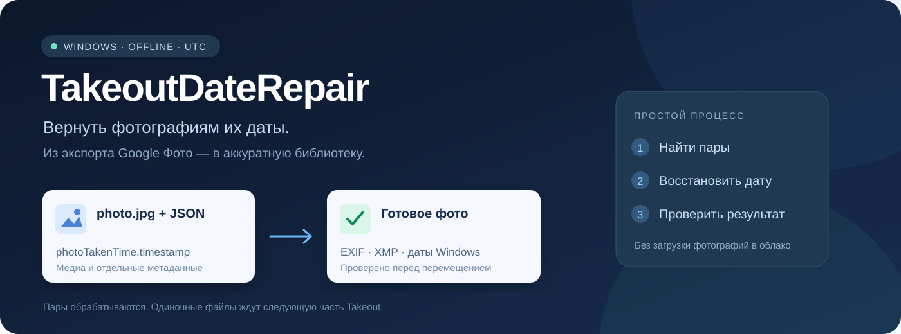
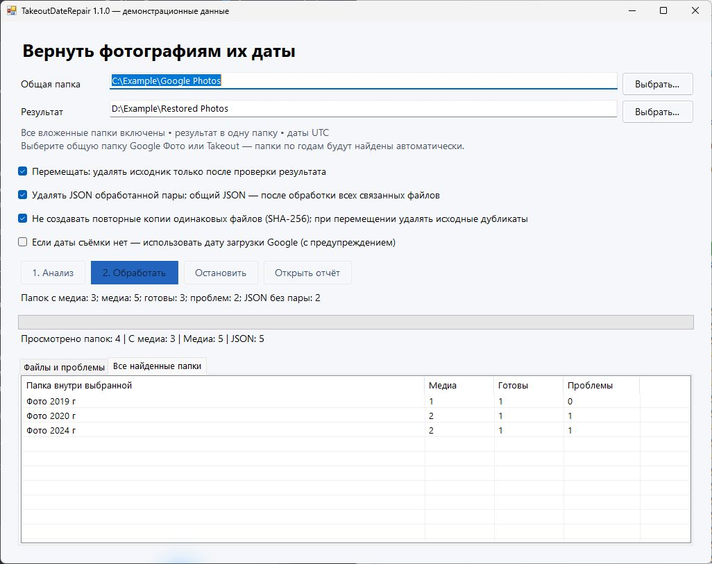

<p align="center">
  
</p>

<p align="center">
  <a href="https://github.com/yargl5/TakeoutDateRepair/releases/latest"></a>
  
  <a href="LICENSE"></a>
</p>

<p align="center"><b>Верните фотографиям дату съёмки. Разберите экспорт Google Фото без ручного поиска JSON.</b></p>

Google Takeout сохраняет фотографии и видео вместе с отдельными JSON-файлами. Дата скачивания может оказаться датой файла в Windows, а дата съёмки — остаться в JSON. **TakeoutDateRepair** находит пары, записывает дату обратно в метаданные и собирает готовые файлы в одну папку.

## Как это выглядит



*Окно приложения с демонстрационными данными. На иллюстрации нет личных фотографий, путей к пользовательскому архиву или настоящих отчётов.*

## Что умеет

| Возможность | Как работает |
|---|---|
| **Автоматический поиск пар** | Рекурсивно ищет фото/видео и соответствующие JSON; учитывает `title`, разные суффиксы и номера копий. |
| **Даты UTC** | Берёт `photoTakenTime.timestamp`, записывает EXIF/XMP, а для поддерживаемого видео — даты QuickTime. |
| **Одна папка результата** | Сохраняет исходные имена; при совпадении добавляет `(2)`, `(3)` и т. д. |
| **Проверка результата** | Проверяет SHA-256 при копировании и повторно читает записанные даты. |
| **Перемещение с очисткой пар** | После проверки удаляет исходный медиафайл и, при включённом флажке, его JSON. |
| **Работа по частям** | Одиночные фото и JSON остаются ждать следующую распакованную часть Takeout. |
| **Дубликаты и повторный запуск** | Использует SHA-256, дату и журнал; перед повторным использованием проверяет готовый файл. |
| **Прогресс и ошибки** | Показывает счётчики, последние сообщения и полный CSV-отчёт. |

## Скачать и запустить

**[Открыть последний релиз →](https://github.com/yargl5/TakeoutDateRepair/releases/latest)**

Скачайте `TakeoutDateRepair.exe` или ZIP с приложением и лицензиями. Установка Python, .NET SDK и отдельного ExifTool не нужна.

**Требования:** Windows 10/11 x64, .NET Framework 4.8. Во время обработки интернет не используется. ExifTool включён в EXE и распаковывается во временную папку при первом запуске.

1. В поле **Общая папка** выберите каталог, внутри которого находятся папки по годам. Можно выбрать `Google Фото`, `Takeout` или их общую родительскую папку — **все уровни вложенности включаются автоматически**.
2. Выберите **Результат** — отдельную папку, которая не вложена в исходную и не содержит её.
3. Нажмите **1. Анализ**. Проверьте количество найденных пар и список проблем.
4. Выберите режим и нажмите **2. Обработать**.

### Все годы за один запуск — v1.1.0+

```text
Выберите эту общую папку
└── Takeout
    └── Google Фото
        ├── Фото 2019 г
        ├── Фото 2020 г
        └── Фото 2024 г
            └── Вложенный альбом
```

После анализа вкладка **Все найденные папки** показывает количество медиа, готовых пар и проблем в каждой подпапке. Все они уже включены в одну очередь: выбирать каждый год и повторять запуск не требуется. Прогресс показывает текущую подпапку, а готовые файлы всех годов собираются в одну целевую папку. Совпадающие имена получают суффиксы без перезаписи.

### Ускорение очереди — v1.2.1

ExifTool запускается один раз на очередь и принимает последовательные команды через официальный протокол `-stay_open`. Вместо отдельного запуска на каждую запись и чтение метаданных используется один процесс. Ошибка конкретного файла не смешивается с ответом следующего; при обрыве процесса исходник сохраняется, а следующий файл получает новый процесс. Команды передаются через отдельный временный UTF-8-файл без BOM: это не зависит от кодировки консоли Windows. После завершения рабочий файл удаляется.

Все проверки SHA-256 сохранены: JSON после анализа, копия до изменения метаданных, исходник **и готовый результат** перед удалением. Общие JSON проверяются через индекс связанных файлов, без полного просмотра всей очереди при каждой очистке. Время обработки и количество запусков ExifTool записываются в итоговый CSV.

Локальный замер итоговой версии на 20 небольших тестовых JPEG и двух ошибочных файлах: отдельные процессы — **24,3 с / 42 запуска**, один процесс — **1,86 с / 1 запуск**. Готовые файлы обоих режимов совпали побайтово. Это замер конкретного набора; для больших видео скорость сильнее зависит от диска и хеширования.

На сохранённых копиях трёх настоящих фото и двух коротких видео (JPEG/MOV/MP4, суммарно около 6,9 МБ) тот же замер дал **5,76 → 1,12 с**. Это небольшая выборка, а не обещание такого же ускорения всей библиотеки. Для независимого повторения добавлен `tests/PerformanceTests.cs`; тест сравнивает число процессов, ошибки и байты результатов, без хрупкого требования к времени на другом компьютере.

Повторные короткие прогоны на четырёх фото дали ускорение от **1,7× до 6×** при разной текущей нагрузке. Отдельный замер не прогнозирует время обработки всей коллекции.

Файлы без пары уже пропускаются до чтения медиаданных и не запускают ExifTool. После распаковки следующего ZIP анализ повторяется, чтобы заметить новые JSON; постоянный кэш «пары нет» мог бы скрыть появившиеся пары. Параллельная запись медиа не включена: одна очередь сохраняет предсказуемую нагрузку на диск и порядок удаления пар.

Обход подпапок был и в v1.0.0; в v1.1.0 он явно обозначен в интерфейсе, дополнен сводкой папок и отдельными тестами сценария с несколькими годами. Ссылки на каталоги не обходятся; ошибки доступа отображаются в отчёте.

Для очень длинных путей действуют ограничения Windows/.NET Framework. Если папка не прочитана, причина будет в отчёте; перенос экспорта ближе к корню диска помогает сократить пути.

> **По умолчанию включены перемещение и удаление JSON обработанных пар.** Перед запуском приложение запрашивает подтверждение. Для копирования без удаления снимите флажок **Перемещать**.

### Что остаётся в исходной папке

- Изображения и видео без подходящего JSON.
- JSON без найденного медиафайла.
- Файлы с ошибками, неоднозначными датами или неподдерживаемой записью метаданных.
- Общий JSON, пока он нужен хотя бы одному оставшемуся связанному исходнику.

Если JSON изменился или исчез после анализа, обработка соответствующего файла не начинается: нужно повторить анализ.

## Несколько ZIP и мало места

Google Takeout может разделить фото и их JSON между разными архивами. Это не обязательно повреждение экспорта.

```text
Части 1 + 2 → анализ → обработка найденных пар → перенос результата на другой SSD
                  ↓
       одиночные файлы остаются
                  + часть 3 в ту же папку
                  ↓
             повторный анализ → новые пары
```

После каждой успешной обработки исходная пара удаляется сразу, если включены соответствующие флажки. Не нужно ждать завершения всей очереди.

**Перемещение между папками одного SSD не освобождает объём самих фотографий.** Место освободится после переноса готовых файлов на другой диск. Для временных операций нужен запас примерно на две дополнительные копии самого большого обрабатываемого файла.

## Какие даты записываются

| Данные | Назначение |
|---|---|
| `photoTakenTime.timestamp` | Основной источник даты съёмки. |
| EXIF `DateTimeOriginal`, `CreateDate`, `ModifyDate` | Поддерживаемые изображения; UTC-смещение `+00:00`. |
| XMP `DateCreated` | Дата с явным UTC (`Z`). |
| QuickTime: контейнер, дорожки, медиапотоки | MP4, MOV, M4V, 3GP и родственные поддерживаемые контейнеры. |
| Даты создания и изменения Windows | Тот же момент времени в файловой системе. |

**Проводник показывает файловые даты в часовом поясе Windows.** Например, `2024-01-01 00:00 UTC` при UTC+3 отображается как `01.01.2024 03:00`. Это один момент времени; встроенные метаданные приложение записывает в UTC.

`creationTime` в Takeout обычно означает дату загрузки, а не дату съёмки. Её использование включается отдельно и отмечается предупреждением. По умолчанию подмена выключена.

Поддержка записи зависит от формата и состояния конкретного файла. Приложение не перекодирует видео и не исправляет повреждённые файлы. Если расширение не соответствует содержимому или ExifTool не поддерживает запись, исходник сохраняется, а причина попадает в отчёт.

## Дубликаты, журнал и остановка

- Дубликатом считается одинаковое исходное содержимое **и одинаковая дата съёмки**, а не просто совпадающее имя.
- Перед использованием уже обработанного файла проверяются его SHA-256 и метаданные.
- При перемещении исходный дубликат удаляется только после проверки готовой копии; JSON — по общим правилам.
- При копировании все исходники и JSON остаются на месте.
- Журнал и CSV находятся в `<папка результата>/_TakeoutDateRepair/`.
- В окне хранятся последние 1500 сообщений; полный список доступен в CSV.
- **Остановить** не обрывает текущую запись метаданных посередине. Остановка на большом видео может занять время; лимит вызова ExifTool — 5 минут.
- Нельзя одновременно обрабатывать одну целевую папку несколькими экземплярами.

Сохраните служебный журнал для повторного запуска. Если перенести готовые файлы в другое место, приложение не ищет их по всем дискам: отсутствующая по прежнему пути копия не будет считаться доступным результатом.

## Конфиденциальность

Обработка выполняется локально. Приложение не отправляет фото, видео, JSON и отчёты на сервер. В этом репозитории опубликованы только код, документация, лицензии и тесты на искусственных данных.

**Локальные CSV и журнал содержат пути и имена ваших файлов.** Не публикуйте их вместе с личным архивом. Фото, видео, JSON, CSV, журналы и временные результаты исключены через `.gitignore`; это дополнительная защита, а не замена проверки файлов перед публикацией.

## Собрать из исходников

В PowerShell на Windows:

```powershell
.\scripts\build.ps1
.\scripts\test.ps1
```

Скрипт сборки скачивает официальный ExifTool 13.59 x64 и проверяет закреплённый SHA-256. Результат: `artifacts/TakeoutDateRepair.exe`. Для сборки без скачивания:

```powershell
.\scripts\build.ps1 -ExifToolZip 'D:\Downloads\exiftool-13.59_64.zip'
```

Тесты создают собственные изображения и JSON в `test-results/`. Они проверяют сопоставление, UTC, кириллицу, отсутствие перезаписи, дубликаты, повторный запуск, остановку, удаление успешных пар и сохранение одиночных файлов. Отдельный набор проверяет одну очередь для нескольких годов, глубоких подпапок и файлов в корне, совпадающие имена, сводку папок и новый год после повторного сканирования. Личная библиотека для тестов не требуется. CI выполняет те же проверки на Windows.

```text
src/                    приложение WinForms и механизм обработки
tests/                  тесты на искусственных данных
scripts/                сборка и запуск проверок
docs/images/            иллюстрации без личных данных
licenses/               лицензии включённых компонентов
```

## Лицензии и благодарности

Код приложения — [MIT](LICENSE). Метаданные читает и записывает [ExifTool](https://exiftool.org/) Фила Харви; Windows-сборку поддерживает [Oliver Betz](https://oliverbetz.de/pages/Artikel/ExifTool-for-Windows). Их компоненты сохраняют собственные лицензии: [THIRD_PARTY_NOTICES.md](THIRD_PARTY_NOTICES.md).

Проект не связан с Google и не является официальным продуктом Google Фото.
